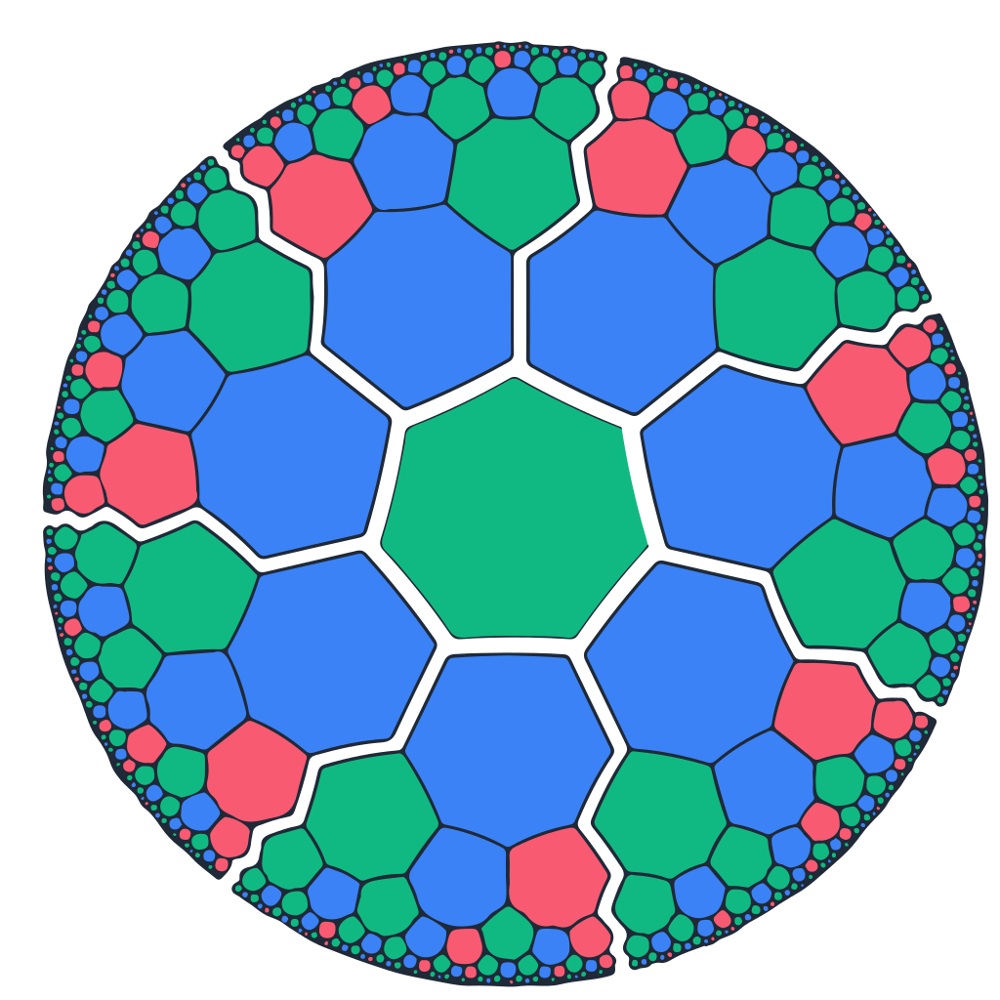

<br/>
<br/>
<br/>
<br/>
<br/>
<br/>
<br/>

<p align='center'>
  <a href="https://www.youtube.com/watch?v=9ftVzOO9Y2I"></a>
</p>

<h3 align='center'>Vibe Theory</h3>
<p align='center'>
  Valenced Information as Base Experience
</p>
<br/>
<br/>
<br/>

A deterministic, reversible ternary quantum cellular automaton on the
infinite 4D `{3,4,3,4}` hyperbolic honeycomb of regular 24-cells,
evolving exact cyclotomic amplitudes in `ℤ[ζ₉][1/6]` with zero floats
and zero PRNGs. Every positive result, effective-theory compatibility
check, and negative control stays in git under a strict three-tier
boundary separating bare QCA runs from background-field bridges and
continuum EFT benchmarks.

- [**A Reversible Ternary Quantum Cellular Automaton on the 4D `{3,4,3,4}` Honeycomb**](https://zenodo.org/records/24503628)
  (Nov 24, 2026)

## 5-Second Quick Start

```sh
git clone https://github.com/cluesurf/vibe.git && cd vibe
npx tsx test/universe.ts
pnpm install
pnpm check:lean
```

## The Core Model (`test/universe.ts`)

[`test/universe.ts`](test/universe.ts) is the standalone, zero-import
core kernel for the bare QCA (the trivial-gauge sector, while gauge
links and extended stores live in [`code/rule/`](code/rule/)). It runs
in under `0.2 s` with exact `BigInt` arithmetic in `ℤ[ζ₉][1/6]`, zero
floats, and zero PRNGs.

- **Space:** Each dock on the 4D `{3,4,3,4}` honeycomb has 24
  directional slots (12 antipodal lines along the roots of `D₄`). Each
  slot holds a ternary tone in `{-1, 0, +1}` plus a 9-state role index,
  where `0` is the neutral quiescent mesh.
- **One beat:** A single reversible step applies 8 layers (6 distinct
  unitary gates) in palindromic order, with `applyBeatInverse` running
  their exact adjoints in reverse.
- **Self-checks:** Running `npx tsx test/universe.ts` verifies `D₄`
  isotropy, `{3,4,3,4}` Coxeter shell counts `[1, 24, 456]`, neutral
  mesh stationarity, exact `W(F₄)⁺` covariance, exact `T`, `CP`, and
  `CPT` invariance alongside genuine `C` and `P` breaking, exact unit
  norm, and exact memoryless reversal.

```ts
// One reversible beat (applied top to bottom):
const BEAT_LAYERS: readonly LayerOp[] = [
  applyOddChiralPhase,     // 1. Scale-4 chiral 4-body phase (Phi_odd)
  applyHalfCoinD,          // 2. First half-coin (Strang split)
  applyOppositeSignBounce, // 3. Opposite-sign bounce (K)
  applyPairLineMixer,      // 4. Pair line mixer (M_pair)
  applyRoleMeet,           // 5. Like-sign role meeting (M_meet)
  applyHalfCoinD,          // 6. Second half-coin
  applyOddChiralPhase,     // 7. Palindromic chiral phase (Phi_odd)
  applyStream,             // 8. Exact hyperbolic stream across docks (S)
]

function applyBeat(state: State): State {
  return BEAT_LAYERS.reduce((cur, layer) => layer(cur, false), state)
}

function applyBeatInverse(state: State): State {
  return [...BEAT_LAYERS]
    .reverse()
    .reduce((cur, layer) => layer(cur, true), state)
}
```

## Repository Layout and Negative-Result Discipline

[`test/registry.csv`](test/registry.csv),
[`test/mesh.csv`](test/mesh.csv), and
[`test/catalog.csv`](test/catalog.csv) are synchronized 1-to-1 at exact
**`1,790` canonical rows** (`0` duplicates, `0` orphans, `0` diffs).
That number is a **cumulative research archive**, not a scoreboard:
retired rules, failed self-keeping runs, negative controls, and early
flat-box explorations stay intact in git alongside the curated Tier
A/B/C runs above.

- [`test/universe.ts`](test/universe.ts): standalone, zero-import,
  pure-`BigInt` core Tier A microscopic QCA (Prettier- and
  ESLint-formatted top-down, `< 0.2 s`)
- [`code/proof/Vibe/`](code/proof/Vibe/): zero-dependency Lean `4.35.0`
  proof suite (`29` `.lean` files including `Vibe/Fock/{Ring,State,Gates,Beat}.lean`
  and root `Vibe.lean`, `341` substantive headline / `451` public theorems,
  `0` `sorry`, `0` `axiom`, `0` `native_decide`, `pnpm check:lean`, fail-closed)
- [`test/verify/`](test/verify/): `30` deterministic
  verification scripts (`27` standalone zero-import plus `3` importing
  `@/code/`) covering the `{3,4,3,4}` spectral collapse (`[11.439047, 11.443713]`),
  unconditional zero-truncation 4D `D_4` mass gap (`SU(2): 0.277274`,
  `SU(3): 0.546000`), all-radius `{3,4,3,4}` `[[24, 1, 8]]_3` HaPPY
  holography (`d = 8 -> 40 -> >= 98`), ballistic no-compacton &
  `Z[omega][1/7]` `k = 3` trion, scattering, universality, 1-hop horizon,
  finite-range chiral wall, Cayley-4-form SMG, and Nelson-Barr CP audits
- [`code/`](code/): Coxeter `{3,4,3,4}` engine, exact cyclotomic QCA
  rules, operators, and measurement library
- [`test/experiment/`](test/experiment/): deterministic registered
  experiments (`pnpm rerun E-GRV-0163`, `pnpm rerun E-FND-0190`)
- [`text/0018-emergent-physics-on-the-fixed-honeycomb/`](text/0018-emergent-physics-on-the-fixed-honeycomb/):
  LaTeX source and 64-page PDF for Paper `0018`
- [`note/experimental-methodology.md`](note/experimental-methodology.md)
  and [`note/architecture.md`](note/architecture.md): grading rubric,
  controls, and codebase map

## Running Experiments and Dev Workflow

```sh
# Core bare-rule kernel (< 0.2 s, zero install needed)
npx tsx test/universe.ts

# Typecheck and unit tests
pnpm test

# Run the full experiment suite
pnpm test:full

# Rerun any single registered experiment by code
pnpm rerun E-GRV-0163
pnpm rerun E-FND-0190

# Inspect recorded metrics for an experiment
pnpm result E-FND-0188

# Run any standalone breakthrough verification script (zero imports)
npx tsx test/verify/combes-thomas-d4-mass-gap.ts
npx tsx test/verify/horizon-one-hop.ts

# Verify the Lean 4.35.0 proof suite (29 files, 341 headline theorems)
pnpm check:lean
pnpm check:lean -- --no-build   # structural + BigInt audit without Lean installed

# Catalog integrity, build, and formatting
pnpm check:labels
pnpm check:constants
pnpm check:coverage
pnpm make
pnpm lint
pnpm format
```

Typical dev workflow:

1. Edit rules, geometry, or measurement helpers in [`code/`](code/) or
   add/update a deterministic experiment in
   [`test/experiment/`](test/experiment/).
2. Run `pnpm rerun <CODE>` to verify gates and negative controls, and
   `pnpm test` to confirm `tsc --noEmit` and core tests stay clean.
3. For formal proofs in [`code/proof/Vibe/`](code/proof/Vibe/), run
   `pnpm check:lean` to verify `lake build` (`0` warnings) and
   `#print axioms`.
4. Rebuild the paper PDF with `make` inside
   [`text/0018-emergent-physics-on-the-fixed-honeycomb/`](text/0018-emergent-physics-on-the-fixed-honeycomb/)
   when manuscript figures or tables change.

## License

MIT. Open for science: use, modify, and build on it freely, with
attribution. See [LICENSE](LICENSE). The written results and figures are
shared under CC-BY-4.0 (attribution).

## ClueSurf

Made by [ClueSurf](https://clue.surf), meditating on the universe.
